# Graph Optimization Backend

<div style="margin:auto;" align="center">
  
</div>

>_"Il tempo è relativo. Può dilatarsi e comprimersi, ma… non può mai tornare indietro..." - Dr. Brand, Interstellar (2014)_

<div align="center">
  <sub>Creato con ❤️ e infinita curiosità</sub>
</div>
<br><br>

[](https://www.docker.com/)
[](https://docs.docker.com/compose/)
[](https://eslint.org/)
[](https://expressjs.com/)
[](https://github.com/)
[](https://developer.mozilla.org/en-US/docs/Web/JavaScript)
[](https://jestjs.io/)
[](https://jwt.io/)
[](https://www.json.org/)
[](https://nodejs.org/)
[](https://www.npmjs.com/)
[](https://www.postgresql.org/)
[](https://www.postman.com/)
[](https://prettier.io/)
[](https://sequelize.org/)
[](https://swagger.io/)
[](https://www.typescriptlang.org/)


## Introduzione
Questo sistema backend è progettato per gestire la **creazione, l’esecuzione e la valutazione di modelli di ottimizzazione su grafi**.  
Supporta i contributi di utenti autenticati per l’aggiornamento dei pesi sugli archi, simulando un **modello di crowd-sourcing** in cui gli utenti collaborano per perfezionare i dati di ottimizzazione.  

Il sistema utilizza **l’algoritmo del cammino minimo di Dijkstra** per l’ottimizzazione dei grafi.  
Tutti gli endpoint API sono **protetti con autenticazione JWT**.    


## Obiettivi del Progetto
- Consentire agli utenti di **creare modelli di ottimizzazione su grafi** con nodi e archi pesati.  
- Eseguire query di percorso minimo tra nodi e restituire risultati con costo e tempo di esecuzione.  
- Fornire un meccanismo per le **richieste di modifica dei pesi**, che richiedono l’approvazione o il rifiuto da parte del proprietario del modello.  
- Supportare il **versionamento** dei modelli di grafo e dei relativi pesi.  
- Consentire la **simulazione di variazioni di peso** per studiarne l’impatto sui risultati.  
- Implementare un **sistema a token**, in cui ogni azione consuma crediti, gestiti tramite utenti autenticati con JWT.  
- Includere funzionalità **Admin** per la ricarica dei token.    


## Funzionalità

- **Autenticazione e Autorizzazione Utente**
  - Autenticazione basata su JWT con algoritmo RS256  
  - Controllo degli accessi basato sui ruoli (**Utente/Admin**)  
  - Hashing sicuro delle password con bcrypt  

- **Gestione Modelli di Grafo**
  - Creazione, recupero, aggiornamento ed eliminazione di modelli di grafo  
  - Sistema di costi basato su token:  
    - `0.20` per nodo  
    - `0.01` per arco  
  - Esecuzione di query di percorso minimo con **Dijkstra**  
  - Tracciamento automatico dei tempi di esecuzione  

- **Richieste di Modifica Pesi**
  - Invio di aggiornamenti sui pesi degli archi (stato: **In attesa, Approvato, Rifiutato**)  
  - Approvazione da parte del proprietario del modello con **smussamento esponenziale**:  
    ```
    p(i,j) = α * p(i,j) + (1 - α) * p_new(i,j)
    ```
  - `α` configurabile in `.env` (default: 0.9)  

- **Versioni dei Modelli**
  - Tracciamento di più versioni per ciascun modello  
  - Filtraggio per data di modifica, numero di nodi o numero di archi  

- **Simulazioni**
  - Simulazione di variazioni di peso su un intervallo con passi incrementali  
  - Restituzione dell’intero set di risultati + configurazione ottimale  
  - Validazione degli input e degli intervalli  

- **Gestione Token**
  - Gli utenti iniziano con un numero iniziale di token (`INIT_USER_TOKENS`, default 100)  
  - I costi in token si applicano alla creazione e all’esecuzione  
  - Richieste non autorizzate quando il saldo è insufficiente  
  - **Rotta di ricarica token riservata all’Admin**  

- **Database e Persistenza**
  - PostgreSQL con ORM Sequelize  
  - Logging delle transazioni (`graph_token_transactions`)  
  - Script Seeder con:  
    - Almeno 2 modelli di grafo  
    - Minimo 10 nodi e 15 archi ciascuno  
    - Più versioni pre-caricate  

- **Documentazione API**
  - Specifica Swagger/OpenAPI (documentazione API interattiva)  
    - http://localhost:3000/api/docs/  
  - Endpoint compatibili con Postman   


## Stack Tecnologico

- **Backend**: 
  - **Node.js** + **Express** – Framework per API
  - **TypeScript** – Sicurezza dei tipi e manutenibilità
- **Database**: 
  - **Sequelize** – ORM per PostgreSQL
  - **PostgreSQL** – Database relazionale
- **Autenticazione**: 
  - **JWT (RS256)** – Autenticazione e autorizzazione
- **Containerizzazione**: 
  - Docker, Docker Compose
- **Documentazione**: 
  - Swagger/OpenAPI
- **Testing**: 
  - Jest


## Installazione

### Prerequisiti (Produzione)
- **Docker Engine** (per eseguire i container)
- **Client PostgreSQL** (per eseguire script SQL se necessario: `graphDDL.sql`, `seeders.sql`)

### Configurazione Locale (Sviluppo)
```bash
npm install
npm run build
npm run start
````

### Configurazione dell’Ambiente

Copia `.env.example` in `.env` e configura i valori:

```env
## Content of .env.example
NODE_ENV=development
API_PORT=3001
APP_TZ=Europe/Rome

# PostgreSQL
POSTGRES_USER=postgres
POSTGRES_PASSWORD=postgres
POSTGRES_DB=graphdb
#dev:localhost / prod:postgres
POSTGRES_HOST=localhost
POSTGRES_PORT=5432
PGSSL=false

# JWT
JWT_PRIVATE_KEY_PATH=./keys/private.key
JWT_PUBLIC_KEY_PATH=./keys/public.key
JWT_EXPIRES_IN=3600
JWT_ALGORITHM=RS256
JWT_SALT_ROUNDS=12
INIT_USER_TOKENS=100
JWT_ISSUER=backend-graphs
JWT_AUDIENCE=api-clients

# Logging / Graph
DB_LOGGING=false
GRAPH_ALPHA=0.9

# Admin user (prod)
ADMIN_EMAIL=admin@test.com
ADMIN_PASSWORD=supersecurepassword
ADMIN_TOKENS=999

```

## Configurazione Docker

### Primo Avvio o Rebuild

```bash
docker compose up --build
# or for detached mode
docker compose up --build -d
```

### Avvii Successivi

```bash
docker compose up
# or for detached mode
docker compose up -d
```

## Configurazione di Sviluppo

La configurazione Docker monta `src` e `tsconfig.json` come volumi, quindi le modifiche a questi file vengono sincronizzate automaticamente con il container.  
Le modifiche ad altri file richiedono invece un rebuild.

## Documentazione API

La documentazione completa delle API è disponibile su `/api/docs` quando il server è in esecuzione.  
Fornisce un’interfaccia interattiva per esplorare tutti gli endpoint, i formati delle richieste/risposte e i requisiti di autenticazione.

```markdown
### Autenticazione

| Metodo | Endpoint              | Descrizione                          |
| ------ | --------------------- | ------------------------------------ |
| POST   | `/api/auth/register`  | Registrare un nuovo utente           |
| POST   | `/api/auth/login`     | Effettuare il login                  |
| GET    | `/api/users/me`       | Ottenere il profilo utente           |
| POST   | `/api/users/recharge` | Ricarica dei token da parte dell’Admin |

### Modelli di Grafo

| Metodo | Endpoint                  | Descrizione             |
| ------ | ------------------------- | ----------------------- |
| POST   | `/api/models`             | Creare un nuovo modello |
| POST   | `/api/models/:id/execute` | Eseguire una query sul modello |
| GET    | `/api/models/:id`         | Ottenere i dettagli del modello |

### Richieste di Modifica Pesi

| Metodo | Endpoint                                                          | Descrizione                        |
| ------ | ----------------------------------------------------------------- | ---------------------------------- |
| POST   | `/api/models/:id/weight-change`                                   | Inviare una richiesta di modifica peso |
| GET    | `/api/models/:id/weight-change?state=pending&fromDate=YYYY-MM-DD` | Filtrare richieste per stato/data  |
| PATCH  | `/api/models/:id/weight-change/:requestId/approve`                | Approvare una richiesta            |
| PATCH  | `/api/models/:id/weight-change/:requestId/reject`                 | Rifiutare una richiesta            |

### Versioni dei Modelli

| Metodo | Endpoint                                             | Descrizione                  |
| ------ | ---------------------------------------------------- | ---------------------------- |
| GET    | `/api/models/:id/versions?nodeCount=12&edgeCount=20` | Filtrare versioni del modello |

### Simulazioni

| Metodo | Endpoint                   | Descrizione                  |
| ------ | -------------------------- | ---------------------------- |
| POST   | `/api/models/:id/simulate` | Eseguire una simulazione sugli archi |
```

## Example Requests

### Create Model

```http
POST /api/models
```

```json
{
  "name": "City_Routes",
  "nodes": ["A", "B", "C"],
  "edges": {
    "A": { "B": 1, "C": 2 },
    "B": { "C": 1 }
  }
}
```

### Execute Model

```http
POST /api/models/1/execute
```

```json
{
  "start": "A",
  "goal": "C"
}
```

### Simulation

```http
POST /api/models/1/simulate
```

```json
{
  "from": "A",
  "to": "B",
  "start": 1,
  "stop": 2,
  "step": 0.1,
  "origin": "A",
  "goal": "C"
}
```

## Struttura del Database

Le entità includono:

- **graph_user** – utenti con ruoli e saldi di token  
- **graph_model** – modelli di grafo con nodi e archi  
- **graph_version** – informazioni di versionamento dei modelli  
- **graph_weight_change_request** – richieste di modifica dei pesi sugli archi (in attesa/approvato/rifiutato)  
- **graph_token_transaction** – log delle transazioni di token (creazione, ricarica, esecuzione)  
- **graph_simulation** – configurazione delle esecuzioni di simulazione (intervalli, passi)  
- **graph_simulation_result** – risultati delle simulazioni (percorsi, costi, tempi di esecuzione)  

Per la documentazione dettagliata del database, vedi [DATABASE_DOC.md](./DATABASE_DOC.md).

Gli **Seeder** forniscono:
* 1 utente Admin, più utenti standard  
* Modelli di grafo iniziali (≥ 10 nodi, ≥ 15 archi)  
* Almeno 2 versioni ciascuno  


````markdown
## Architettura & Design Patterns

InferNode implementa un’architettura **multilivello** con alcuni design pattern per garantire manutenibilità e separazione delle responsabilità.

## Architettura a Livelli

L’applicazione segue un pattern architetturale a livelli con separazione delle responsabilità:

```text
┌─────────────────────────────────────────────────────┐
│                     Router                          │ ← Definizione delle rotte
├─────────────────────────────────────────────────────┤
│                   Controllers                       │ ← Gestione delle richieste
├─────────────────────────────────────────────────────┤
│                    Services                         │ ← Logica di business
├─────────────────────────────────────────────────────┤
│                  Repositories                       │ ← Accesso ai dati
├─────────────────────────────────────────────────────┤
│                      DAO                            │ ← Operazioni sul database
├─────────────────────────────────────────────────────┤
│                     Models                          │ ← Strutture dati
└─────────────────────────────────────────────────────┘
````

Il flusso per la gestione delle richieste segue questo percorso:

1. **Router**: definisce gli endpoint API e instrada le richieste ai controller appropriati
2. **Controllers**: gestiscono le richieste/risposte HTTP e delegano la logica ai servizi
3. **Services**: implementano la logica di business e orchestrano le operazioni
4. **Repositories**: forniscono un livello di astrazione per le operazioni di accesso ai dati
5. **DAO (Data Access Objects)**: eseguono operazioni sul database e gestiscono le query
6. **Models**: definiscono lo schema del database, le relazioni e le strutture dati

```

## Implementazione dei Design Pattern Architetturali

### 1. **Repository Pattern**
- Fornisce un’**interfaccia coerente** per operazioni CRUD e personalizzate.  
- Incapsula i DAO ed espone ai servizi **metodi di persistenza orientati al business**.  
- Esempi nel progetto:  
  - `user.repository.ts` → gestisce gli utenti  
  - `model.repository.ts` → gestisce i modelli di grafo e le versioni  
  - `simulation.repository.ts` → gestisce le simulazioni  
  - `weight-change.repository.ts` → gestisce le richieste di modifica pesi  


```typescript
export class ModelRepository {
  async createModelWithVersion(args: any, opt?: Tx){ /* ... */}
  async getLatestVersion(modelId: number, opt?: Tx){ /* ... */}
  async getModel(modelId: number, opt?: Tx){ /* ... */}
};
````
* **Repository Layer (`/src/repository`)** → Metodi di persistenza orientati al business costruiti sui DAO.

### 2. **Data Access Object (DAO) Pattern**

* Operazioni **Sequelize di basso livello** con gestione degli errori e logging.  
* Ogni DAO implementa una specifica interfaccia (`.idao.ts`) per garantire coerenza.  
* Esempi nel progetto:

  * `model.dao.ts` → persistenza per `graph_model` e `graph_version`  
  * `user.dao.ts` → persistenza per `graph_user`  
  * `simulation.dao.ts` → persistenza per `graph_simulation`  
  * `weight-change.dao.ts` → persistenza per `graph_weight_change_request`  

```typescript
const ModelDao = {
  async createModel(data: Partial<GraphModel>, opt?: Tx){ /* ... */},
  async createVersion(data: Partial<GraphVersionModel>, opt?: Tx){ /* ... */},
  async findModelByPk(id: number, opt?: Tx){ /* ... */},
  async findVersion(modelId: number, version: number, opt?: Tx){ /* ... */},
  async findLatestVersion(modelId: number, opt?: Tx){ /* ... */}
};
```
* **DAO Layer (`/src/dao`)** → Operazioni raw sul database (Sequelize), gestione degli errori, logging.

## Implementazione dei Design Pattern

Il progetto utilizza diversi design pattern per migliorare l’organizzazione del codice, la manutenibilità e la scalabilità.  
Di seguito i principali pattern impiegati:

### 1. Creational Patterns

- **Singleton** – `src/database/database.ts`  
  Garantisce un’unica istanza di connessione al database in tutta l’applicazione.  

```typescript
export class Database {
  private static instance: Database;

  private constructor() { /* init connection */ }

  public static getInstance(): Database {
    if (!Database.instance) {
      Database.instance = new Database();
    }
    return Database.instance;
  }
}
````

* **Abstract Factory** – `src/common/security/security-factory.ts`  
  Centralizza la creazione delle diverse strategie di sicurezza (`jwt-strategy.ts`, `password-strategy.ts`).  

* **Builder** – `src/service/model/model-builder.ts`  
  Costruisce i modelli di grafo passo dopo passo (nodi, archi, metadati).  

### 2. Structural Patterns

* **Adapter** – `src/service/model/model-adapter.ts`  
  Adatta i dati grezzi di input nella struttura richiesta dall’algoritmo `node-dijkstra`.  

* **Facade** – `src/service/model/model-facade.ts`, `src/service/simulation/simulation-facade.ts`  
  Fornisce interfacce semplificate a sottosistemi complessi (creazione/validazione del modello, workflow di simulazione).  

```typescript
export class ModelFacade {
  createAndValidateModel(data: any) {
    const builder = new ModelBuilder();
    const model = builder.setNodes(data.nodes).setEdges(data.edges).build();
    return new ModelValidator().validate(model);
  }
}
```

* **Decorator** – `src/middleware/` (`authentication.middleware.ts`, `authorization.middleware.ts`, `validate.middleware.ts`)  
  Aggiunge responsabilità trasversali (autenticazione, validazione, gestione errori) avvolgendo la gestione delle richieste.  

### 3. Behavioral Patterns

* **Command** – `src/service/model/validation/create-model-command.ts`, `execute-model-command.ts`  
  Incapsula le azioni (creazione modello, esecuzione) come oggetti comando, rendendole riutilizzabili e consistenti.  

* **Observer** – `src/service/model/model-observer.ts`  
  Osserva i cambiamenti (come aggiornamenti di peso) e reagisce con versionamento o notifiche.  

* **Strategy** – `src/service/simulation/simulation-strategy.ts`  
  Definisce algoritmi intercambiabili per la simulazione (ad es. basata su intervalli o a passi).  


```typescript
interface SimulationStrategy {
  runSimulation(data: any): any;
}

class RangeSimulation implements SimulationStrategy {
  runSimulation(data: any) {
    return `Simulating with step ${data.step}`;
  }
}

class SimulationContext {
  constructor(private strategy: SimulationStrategy) {}
  execute(data: any) { return this.strategy.runSimulation(data); }
}
```

* **Chain of Responsibility** – `src/middleware/`
  Le richieste passano attraverso una catena di middleware (`authentication → authorization → validation → error handler`).

### Summary

* **Database** → Singleton
* **Security** → Abstract Factory (auth strategies)
* **Middleware** → Chain of Responsibility + Decorator
* **Model Services** → Builder, Adapter, Facade, Observer, Command
* **Simulation Services** → Strategy, Facade

## Design

### Attori

* **Utente non autenticato** – Può registrarsi ed effettuare il login nel sistema.  
* **Utente autenticato** – Attore base che interagisce con il sistema.  
  * **Utente** – Crea/esegue modelli, invia richieste di modifica pesi, esegue simulazioni.  
  * **Amministratore** – Gestisce i token, approva/rifiuta le richieste di modifica pesi.  

<div style="overflow:hidden; margin:auto;" align="center">
  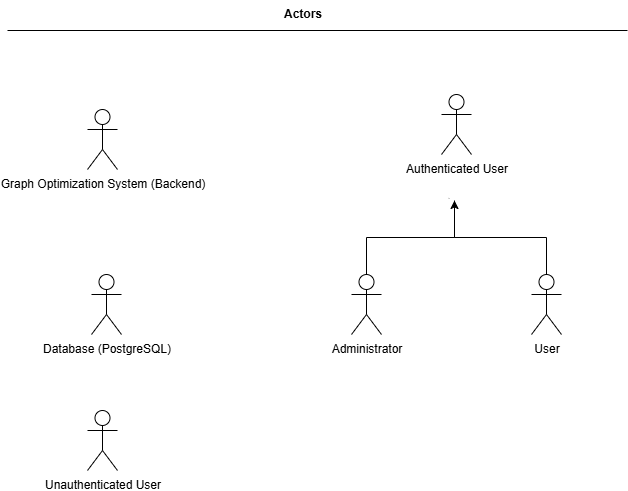
</div>

### Casi d’Uso

* **Registrazione / Login utente** – Gli utenti non autenticati possono registrarsi e autenticarsi tramite JWT.  
* **Creazione modello di grafo** – Gli utenti possono creare un nuovo modello di grafo (se hanno token sufficienti).  
* **Esecuzione modello (percorso minimo con Dijkstra)** – Gli utenti possono eseguire il modello per trovare il percorso ottimale tra i nodi.  
* **Invio richiesta di modifica peso** – Gli utenti possono richiedere un aggiornamento dei pesi sugli archi.  
* **Approvazione / Rifiuto modifica peso** – I proprietari del modello o gli admin possono approvare o rifiutare le richieste in sospeso.  
* **Esecuzione simulazioni** – Gli utenti possono simulare variazioni di peso su un arco.  
* **Ricarica token (Admin)** – Gli amministratori possono ricaricare i token degli utenti.  

<div style="overflow:hidden; margin:auto;" align="center">
  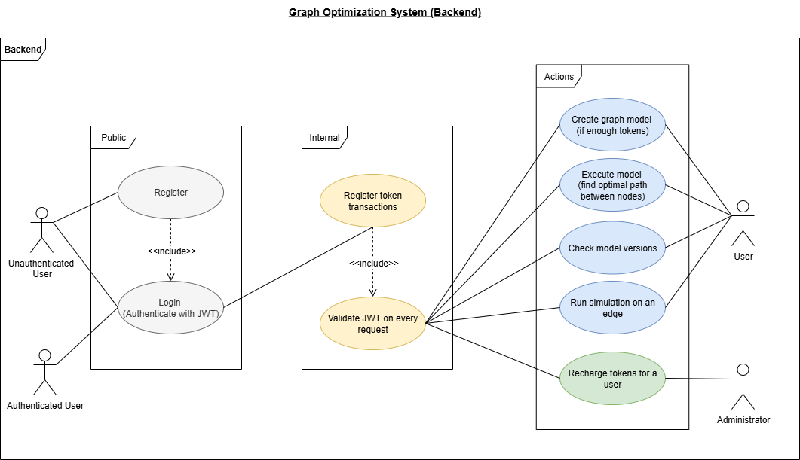
</div>

### Diagrammi di Sequenza

### Flusso di autenticazione utente
* Registrazione
<div style="overflow:hidden; margin:auto;" align="center">
  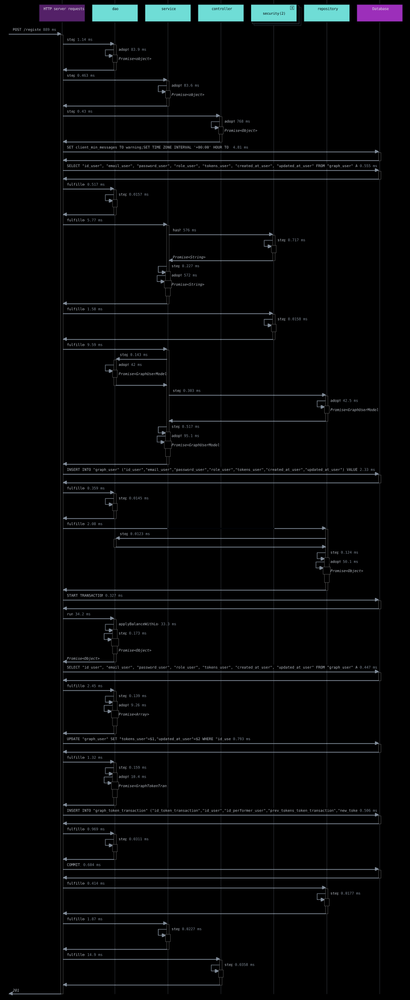
</div>

* Login
<div style="overflow:hidden; margin:auto;" align="center">
  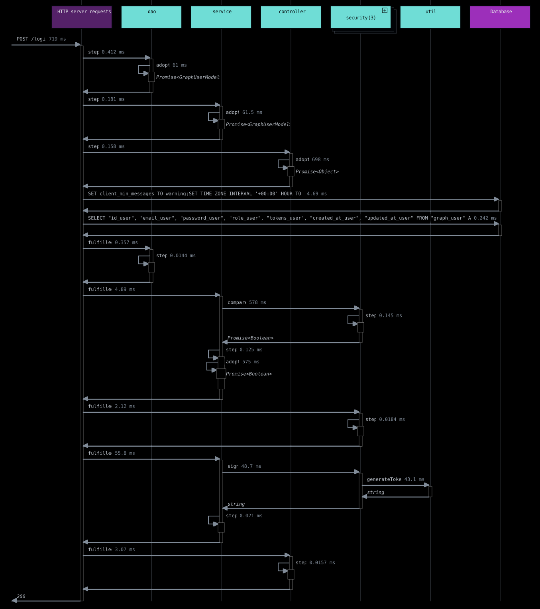
</div>

* Informazioni Utente
<div style="overflow:hidden; margin:auto;" align="center">
  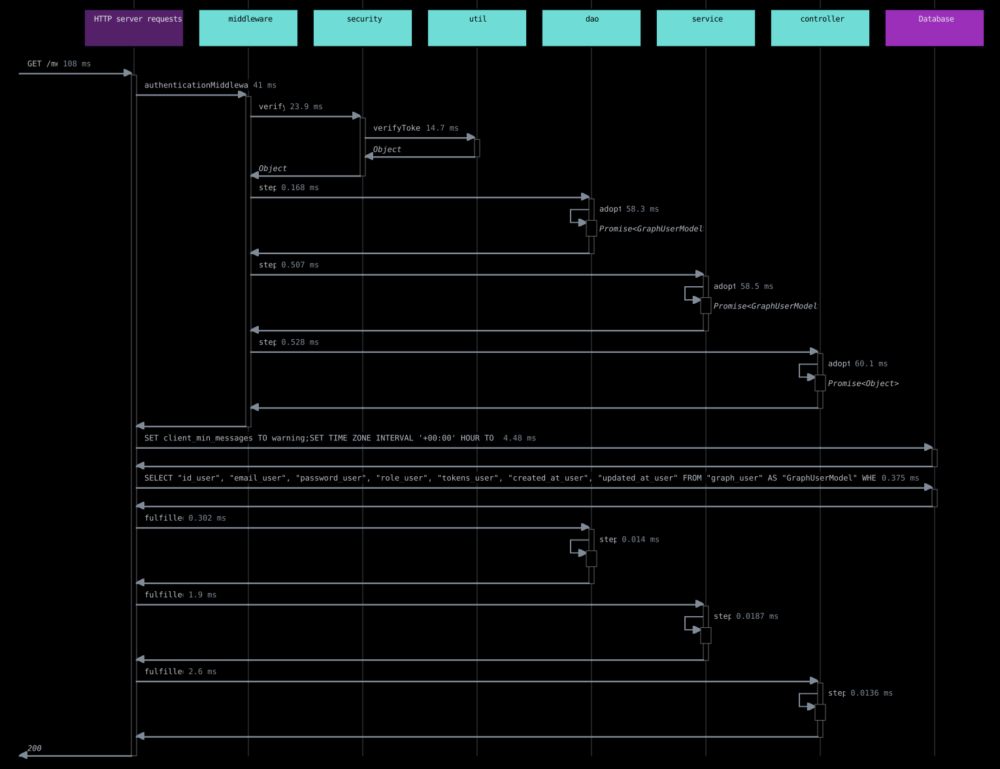
</div>

* Ricarica Token (solo Admin)
<div style="overflow:hidden; margin:auto;" align="center">
  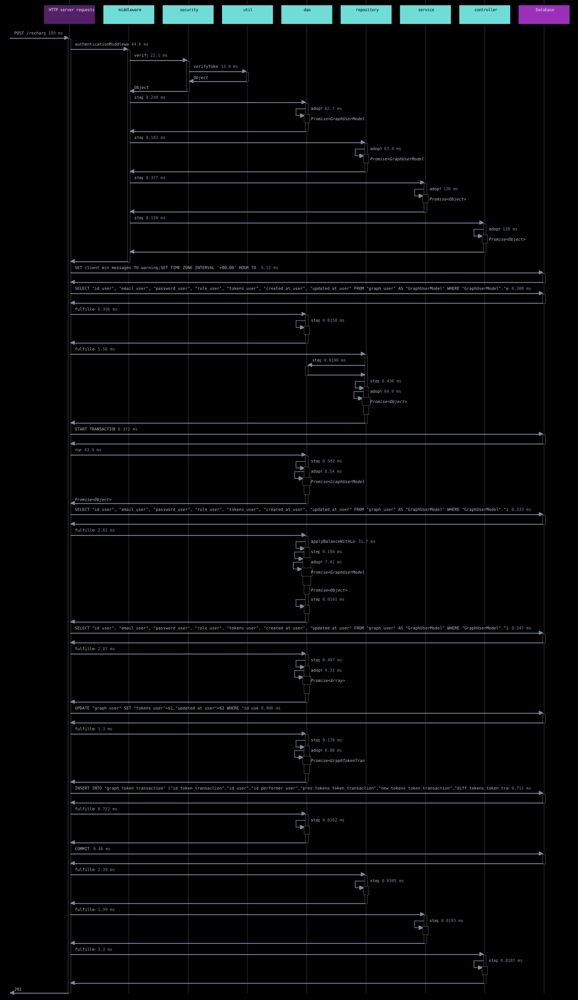
</div>

### Flusso del Modello di Grafo

#### Ciclo di vita di creazione ed esecuzione
* Creazione modello + deduzione token
<div style="overflow:hidden; margin:auto;" align="center">
  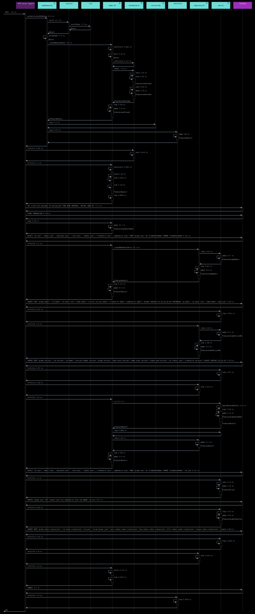
</div>

* Esecuzione del percorso minimo con Dijkstra
<div style="overflow:hidden; margin:auto;" align="center">
  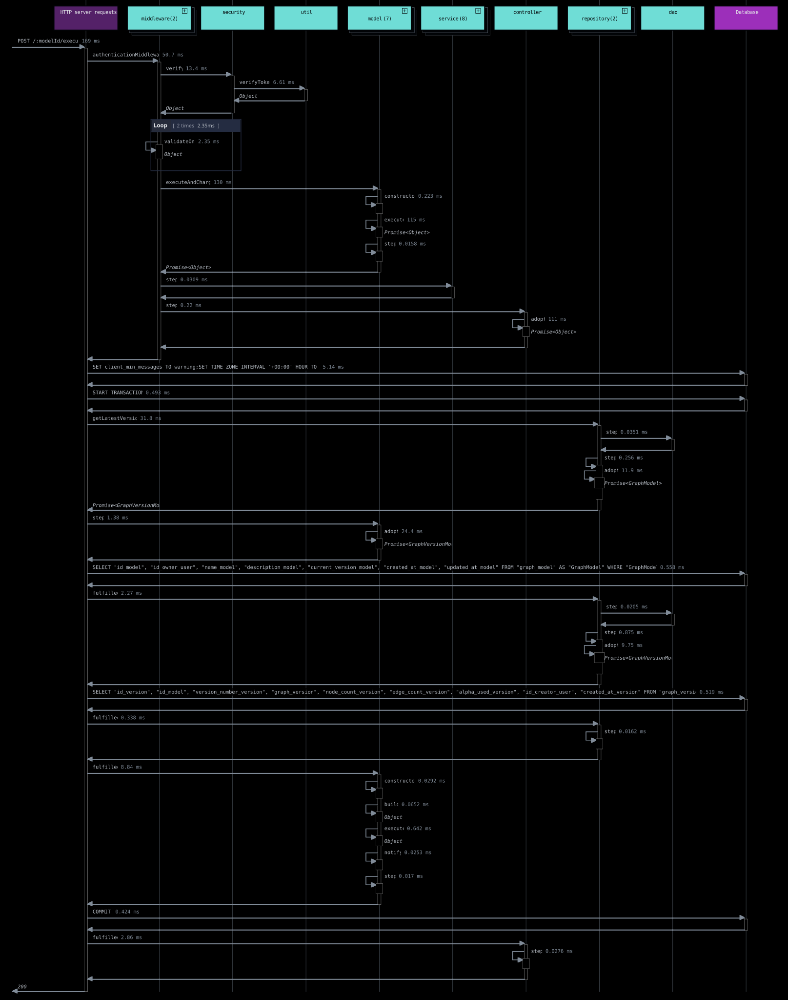
</div>

#### Ciclo di vita della richiesta di modifica peso
* Approvazione della richiesta di modifica peso
<div style="overflow:hidden; margin:auto;" align="center">
  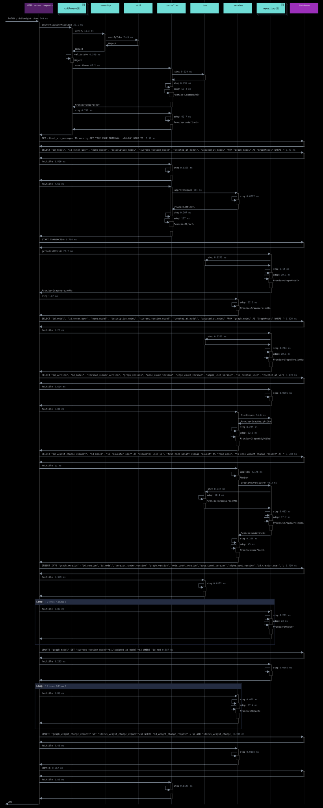
</div>

* Rifiuto della richiesta di modifica peso
<div style="overflow:hidden; margin:auto;" align="center">
  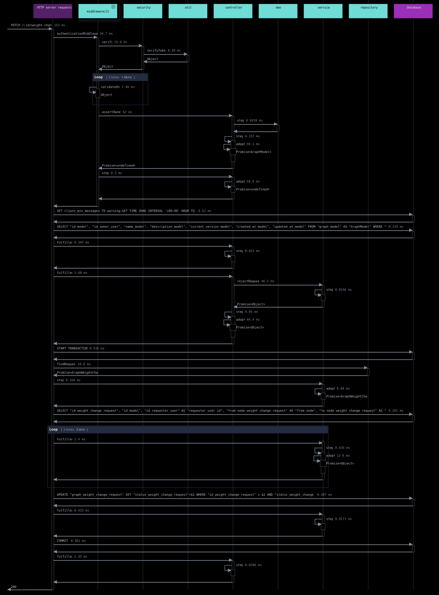
</div>

#### Versioni del modello e filtraggio
* Versionamento del modello
<div style="overflow:hidden; margin:auto;" align="center">
  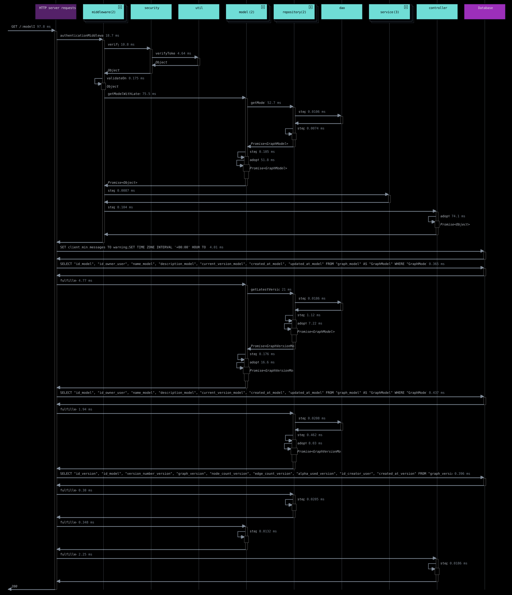
</div>

* Filtraggio del modello
<div style="overflow:hidden; margin:auto;" align="center">
  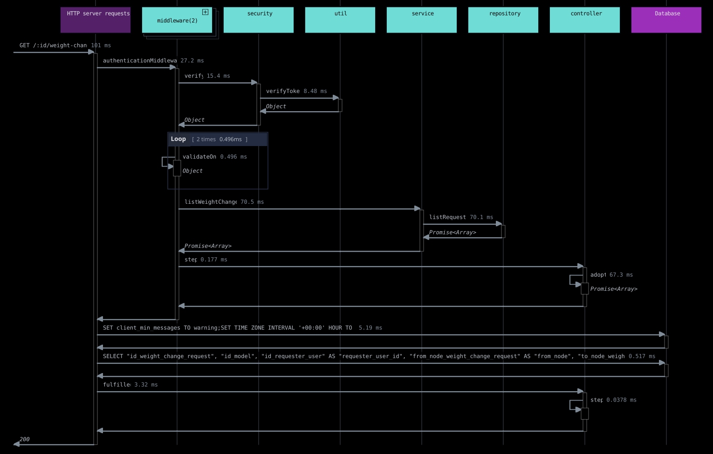
</div>

#### Ciclo di vita della simulazione
<div style="overflow:hidden; margin:auto;" align="center">
  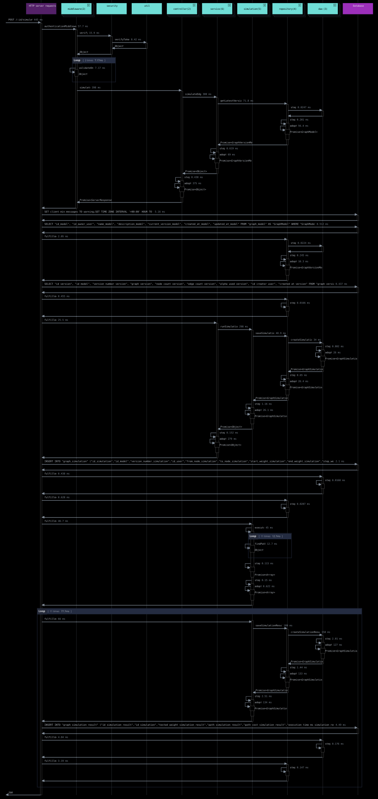
</div>

# Test

To run tests:

```bash
docker exec -it backend_graphs npm test

```

# License

This project is licensed under the MIT License - see the [LICENSE](./LICENSE) file for details.
